# notebooks — 演習の実行結果まとめ

アリ・ハチの写真を分類するAIで、**データ拡張（写真を反転・切り抜きなどで加工して学習データを増やす工夫）の効果**を学ぶ演習です。
このページは、6本のNotebook（00〜05）を**実行したときに何が起こり、何が分かるか**を、結果の図・表つきでまとめたものです。
**Notebookを開く前の予習**にも、**実行後の答え合わせ**にも使えます。

## このページの見方

- 図・表の数値は、**3つの乱数シード（0・1・2）の平均**です。各NotebookをQUICK=False（本実験）で実行したときと同じ条件で、プロジェクトの実験記録（`outputs/results.csv`）から集計しました。
  `QUICK = True`（1シード）で実行すると、数値は少しずれます。**傾向**が同じであることを確認してください。
- `±` の後ろの数字は**ばらつき（標準偏差）**です。**差がこの値より小さいときは、誤差の可能性が高い**ので注意してください。
- 精度は**正解率**（0.80 ＝ 10枚中8枚正解）。`test` は学習に使っていない写真での成績で、**これが本当の実力**です。
- `gap` は **train精度 − val精度**。大きいほど**過学習**（学習用の写真を丸暗記している状態）です。
- 用語が分からないときは [00_setup_data.ipynb](00_setup_data.ipynb) の「用語集」を見てください。
- 詳しい考察は [../MANUAL.md](../MANUAL.md) にあります。

## Notebook一覧

| Notebook | 答える問い | 結論（一言） | 目安時間 |
|---|---|---|---|
| [00_setup_data](00_setup_data.ipynb) | 実験に使うデータは？ | 243枚の学習用写真に、検証用76枚・本番用77枚。**分割は拡張の前** | 1〜2分 |
| [01_visualize_augment](01_visualize_augment.ipynb) | 拡張すると写真はどう変わる？ | 拡張は**ランダム**。強すぎると不自然になる。**必ず目で確認する** | 1分 |
| [02_baseline](02_baseline.ipynb) | 拡張なしだと、どうなる？ | trainは0.86、valは0.72。**過学習**する。結果は**シードでぶれる** | 1〜2分 |
| [03_augment_vs_none](03_augment_vs_none.ipynb) | 拡張すると、良くなる？ | 十分に学習すると、testが **0.701 → 0.796**。ただし**学習が遅くなる** | 約3分 |
| [04_ablation](04_ablation.ipynb) | どの拡張が効く？ 写真が少なすぎたら？ | **切り抜きが最も効く**。色調は無効。**拡張はデータの代わりにならない** | 約15分 |
| [05_advanced](05_advanced.ipynb) | もっと良い方法は？ | **転移学習が最大の改善**（0.70 → 0.89 → 0.94）。Mixup/CutMixは小さなAIでは逆効果 | 約15分 |

---

## 00. 環境確認とデータ準備 — [00_setup_data.ipynb](00_setup_data.ipynb)

**このNotebookのゴール**: 演習全体の目的を理解し、実験用のデータを用意する。

**やること**
1. 演習のゴールと全体像を読む（アリ・ハチの分類AIを、少ない写真で賢くする）
2. 写真をダウンロードして **train / val / test** に分ける
3. 写真を自分の目で眺める
4. 3つのグループに**同じ写真が混ざっていない**ことを確認する（データリーク対策）

### 実行結果

分割後の写真の枚数（シード42で固定。毎回同じ分け方になる）:

| グループ | アリ | ハチ | 合計 | 用途（たとえ） |
|---|---|---|---|---|
| **train**（学習用） | 122 | 121 | **243** | AIが学ぶ（教科書）。**拡張はここだけ** |
| **val**（確認用） | 35 | 41 | 76 | 学習中に実力を測る（模擬試験） |
| **test**（本番用） | 35 | 42 | 77 | 最後に**1回だけ**成績をつける（本番） |

学習用の写真の例（上段: アリ8枚、下段: ハチ8枚）。向き・大きさ・背景が写真ごとにバラバラです。

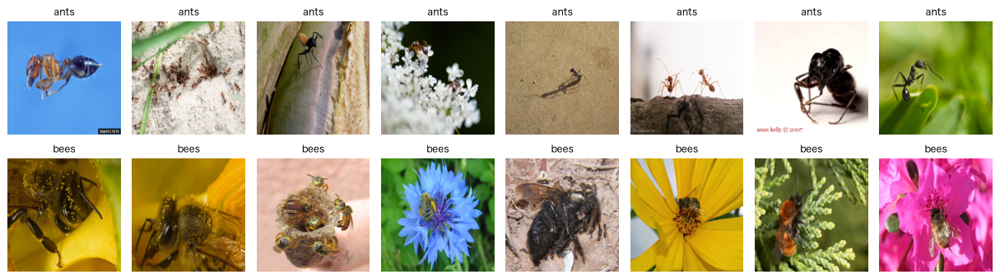

重複チェックの出力:
```
train と val の重複: 0件
train と test の重複: 0件
val と test の重複: 0件
重複なし ✔
```

### 読み取れること
- 学習用の写真は**243枚**と、AIの学習としては**非常に少ない**。だから**過学習しやすく、拡張の効果が見えやすい**。
- 写真の**向き・大きさ・背景がバラバラ**。この「ばらつき」を、拡張で人工的に再現して補うのが、データ拡張の狙い。
- **分割は拡張の前**に行う。拡張後に分けると、同じ写真の反転版が train と test に分かれ、**答えを見ながらテストを受ける**状態（データリーク）になる。

### 演習
- `[:8]` を `[8:16]` に変えて、別の写真も見る（スライスの意味を理解する）
- `index` を変えて、写真を1枚ずつ大きく見る
- （上級）`SEED` を変えてデータの分け方を変える。**必ず42に戻す**

---

## 01. データ拡張で写真はどう変わる？ — [01_visualize_augment.ipynb](01_visualize_augment.ipynb)

**このNotebookのゴール**: 拡張が写真をどう変えるかを**自分の目で見て**理解する。「人間が見ても同じアリ（ハチ）に見えるか」を確認する習慣をつける。

**やること**
1. 10種類の拡張を、1枚の写真に**1つずつ**かけて並べる
2. 拡張が**ランダム**で、毎回結果が違うことを確認する
3. 拡張の**強さ**を変えて、見た目の違いを見る
4. 複数の拡張を**組み合わせる**

### 実行結果

**① 拡張ギャラリー**（左上が元の写真、他が各拡張をかけた結果）

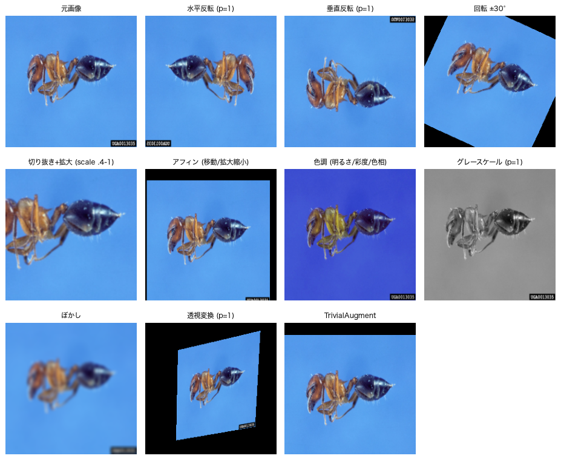

**② ランダム切り抜きを8回**（同じ操作でも毎回違う場所が切り出される）

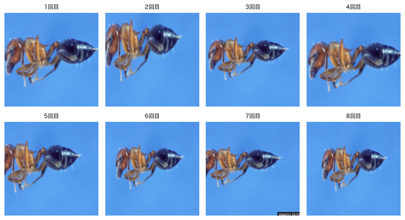

**③ 強さを変えた比較**（1行目: 回転 10→90度 ／ 2行目: 切り抜き 80%→8%残す ／ 3行目: 色調 弱→強 ／ 4行目: ぼかし 弱→強）

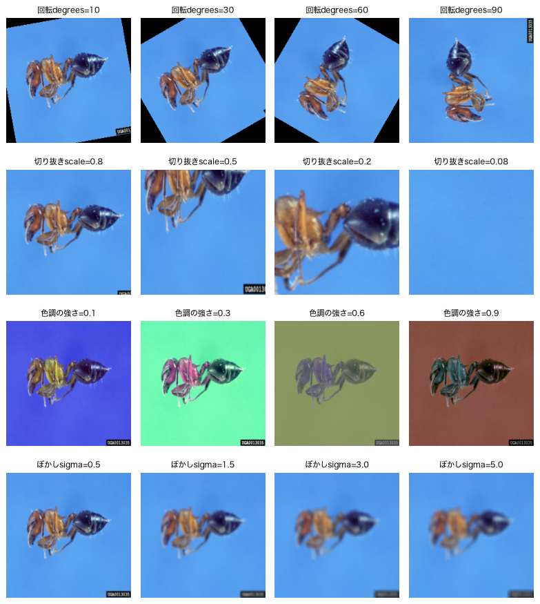

**④ 組み合わせ（basic = 切り抜き → 反転 → 色調）を8回**

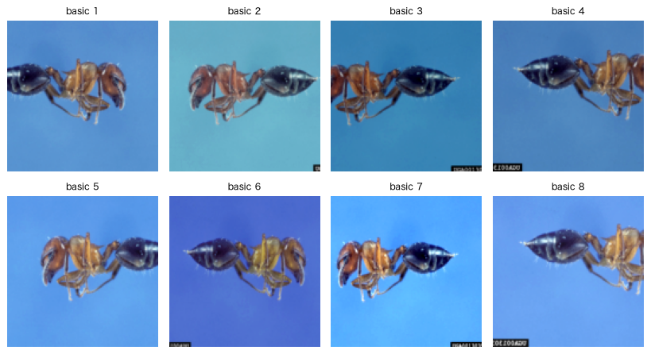

### 読み取れること
- 回転・アフィン・透視変換は、画像の**角が黒く**なる。AIが黒い部分を手がかりにしてしまう恐れがある。
- 水平反転では、写真の隅の撮影ID（UGA…）が**鏡文字**になる。写真の中の文字は、アリ/ハチと無関係。
- 拡張は**ランダム**。**エポック（全写真を1周する単位）ごとに拡張をやり直す**ので、1枚の写真がエポックの数だけ「違う見え方」で使われる。これが「写真が増える」の正体。
- **強すぎる拡張は逆効果**。たとえば切り抜きで8%しか残さないと、アリが写っていない写真ができ、「アリ」というラベルが**嘘**になる。**弱めから試す**のが基本。
- **「人間が見てもそのクラスと分かる」拡張だけを使う**。

### 演習
- 回転の強さを `[5, 15, 45, 180]` にして、**180度**でも自然か考える
- アリの代わりにハチの写真で試す
- （コード不要）**手書き数字の6と9**を分類するなら、どの拡張が危険か？（→ 回転・上下反転）

---

## 02. 拡張なしで学習する（ベースライン） — [02_baseline.ipynb](02_baseline.ipynb)

**このNotebookのゴール**: 拡張なしでAIを学習させ、**過学習**を実際に見る。拡張の効果を測るための**基準（ベースライン）**を作る。

**やること**
1. AI（畳み込み3層の小さなCNN。パラメータ約2万4千個）の中身を見る
2. 拡張なし（60エポック）で学習し、**学習曲線**を描く
3. 学習曲線から**過学習**を読み取る
4. シードを変えて、**結果がぶれる**ことを確認する

### 実行結果

**学習曲線**（拡張なし、シード0、60エポック。左: loss＝間違いの大きさ ／ 右: 精度）

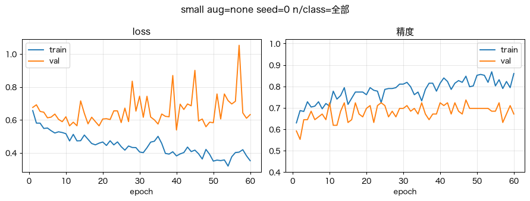

**3つのシードの結果**（60エポック・拡張なし）

| シード | train | val | test | gap |
|---|---|---|---|---|
| 0 | 0.860 | 0.671 | 0.792 | 0.189 |
| 1 | 0.852 | 0.737 | 0.818 | 0.115 |
| 2 | 0.864 | 0.750 | 0.818 | 0.114 |
| **平均** | **0.859** | **0.719** ±0.042 | **0.809** ±0.015 | **0.139** |

### 読み取れること
- **train の loss は下がり続ける**のに、**val の loss は下がらず**、むしろ上下に荒れる。train 精度（約0.86）が val 精度（約0.72）を**大きく上回る**。→ **過学習**のサイン。
- val の線が**ギザギザ**なのは、val が76枚と少なく、**1枚の判定が変わるだけで精度が約1.3ポイント動く**から。
- **シードを変えるだけで、valが 0.671〜0.750 とぶれる**（約8ポイントの差）。1回の結果だけで「拡張Aが良い」と判断するのは危険。**比較は複数シードの平均で行う**。
- この **train 0.859 / val 0.719 / test 0.809** が、以降の比較の**基準**になる。

### 演習
- エポックを `ep(20)` / `ep(60)` / `ep(150)` に変えて、gap（差）がどう変わるか見る
- `QUICK = False` にして3回の平均とばらつき（`±`）を見る
- `lr=0.01` を指定して、学習率（1回の更新の大きさ）の影響を見る

---

## 03. 拡張あり vs 拡張なし — [03_augment_vs_none.ipynb](03_augment_vs_none.ipynb)

**このNotebookのゴール**: **同じ条件で**拡張あり・なしを比べ、拡張が過学習を抑えて、初めて見る写真への正解率を上げるかを確かめる。**拡張には学習が遅くなる副作用がある**ことを理解する。

**やること**
1. 学習中、写真が**どう加工されてAIに渡されるか**を見る
2. 拡張なし vs 拡張あり（basic）を、**同じ条件**（拡張の有無だけを変える）で学習して比べる
3. 学習曲線と成績の表を読む
4. 学習回数（エポック）で結論が変わることを知る

### 実行結果

**学習曲線**（150エポック、シード0。上段: 拡張なし ／ 下段: 拡張あり）

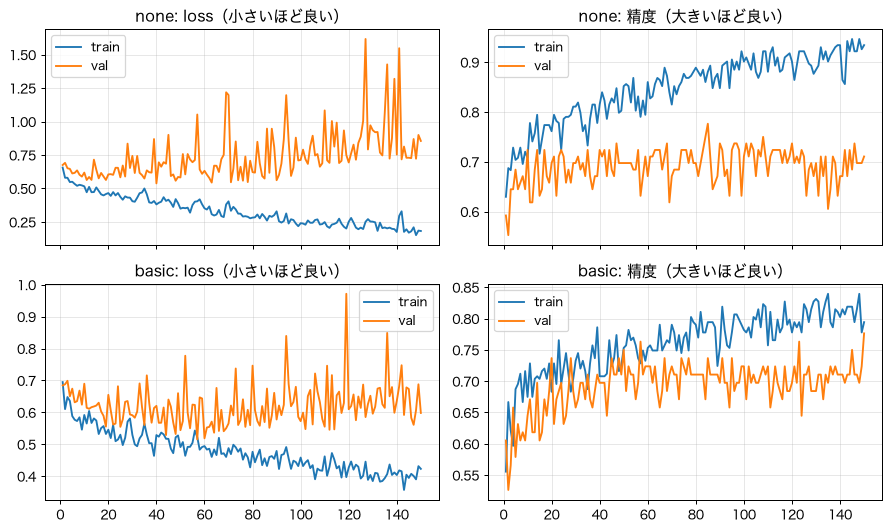

**成績の比較**（3シード平均）

| エポック | 条件 | train | val | test | gap |
|---|---|---|---|---|---|
| 60 | 拡張なし | 0.859 | 0.719 | **0.809** ±0.015 | 0.139 |
| 60 | 拡張あり(basic) | 0.756 | 0.715 | **0.757** ±0.079 | 0.041 |
| 150 | 拡張なし | 0.945 | 0.711 | **0.701** ±0.034 | 0.235 |
| 150 | 拡張あり(basic) | 0.822 | 0.732 | **0.796** ±0.008 | 0.089 |

### 読み取れること
1. **60エポックでは、拡張の効果は見えない。** gapは小さくなる（0.139 → 0.041）が、test は拡張なし（0.809）のほうが**むしろ高い**。拡張ありは**学習が遅く**、train精度が 0.756 までしか上がっていない。
2. **150エポックまで学習すると、差が出る。** 拡張なしは、学習を続けるほど過学習が進み、**test が 0.809 → 0.701 に悪化**する。拡張ありは **0.796 を維持**する（約 **+9.5ポイント**）。
3. **教訓: 拡張は「過学習を抑える」代わりに「学習が遅くなる」。** 十分な回数、学習してから比べないと、拡張の効果を見誤る。60エポックだけで比べたら「拡張は効かない」と誤った結論になる。
4. 学習曲線で、拡張なし（上段）は train と val が大きく離れる。拡張あり（下段）は差が小さい。
5. ばらつきに注意。60エポックの拡張ありは ±0.079 と大きく、差が誤差の範囲のことがある。

### 演習
- `EPOCHS = ep(60)` に変えて、**学習が足りないと拡張の効果が見えない**ことを確認する
- `QUICK = False` で3回の平均を見て、差が `±` より大きいか確かめる
- 切り抜きの強さ `scale=(0.3, 1.0)` を試す（終わったら `(0.6, 1.0)` に戻す）

---

## 04. どの拡張が効く？ 写真が少なすぎたら？ — [04_ablation.ipynb](04_ablation.ipynb)

**このNotebookのゴール**: ① 拡張を**1種類ずつ**試して、効くもの・効かないものを見分ける方法（**アブレーション**）を身に付ける。② 学習用の写真が少ないとき、拡張の効果がどう変わるかを知る。

**やること**
1. 5条件（拡張なし／水平反転のみ／切り抜きのみ／色調のみ／全部入り）を、150エポックで比べる
2. クラスあたり10・30・60枚に減らして、拡張あり・なしを比べる（300エポック）

### 実行結果

**① アブレーション**（150エポック・3シード平均）

| 条件 | train | val | test | gap |
|---|---|---|---|---|
| 拡張なし | 0.945 | 0.711 | **0.701** ±0.034 | 0.235 |
| 水平反転のみ | 0.904 | 0.733 | **0.757** ±0.020 | 0.172 |
| ランダム切り抜きのみ | 0.915 | 0.737 | **0.835** ±0.040 | 0.178 |
| 色調変更のみ | 0.874 | 0.680 | **0.701** ±0.098 | 0.194 |
| 切り抜き+反転+色調(basic) | 0.822 | 0.732 | **0.796** ±0.008 | 0.089 |

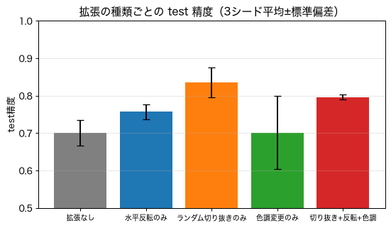

**② 学習枚数の影響**（300エポック・3シード平均。「10枚/クラス」はアリ10枚＋ハチ10枚＝合計20枚で学習）

| 枚数/クラス | 条件 | train | val | test | gap |
|---|---|---|---|---|---|
| 10 | 拡張なし | 1.000 | 0.614 | **0.640** ±0.098 | 0.386 |
| 10 | 拡張あり(basic) | 0.967 | 0.631 | **0.636** ±0.047 | 0.335 |
| 30 | 拡張なし | 0.994 | 0.645 | **0.731** ±0.042 | 0.350 |
| 30 | 拡張あり(basic) | 0.916 | 0.675 | **0.727** ±0.057 | 0.241 |
| 60 | 拡張なし | 0.992 | 0.689 | **0.658** ±0.076 | 0.303 |
| 60 | 拡張あり(basic) | 0.886 | 0.733 | **0.731** ±0.038 | 0.154 |

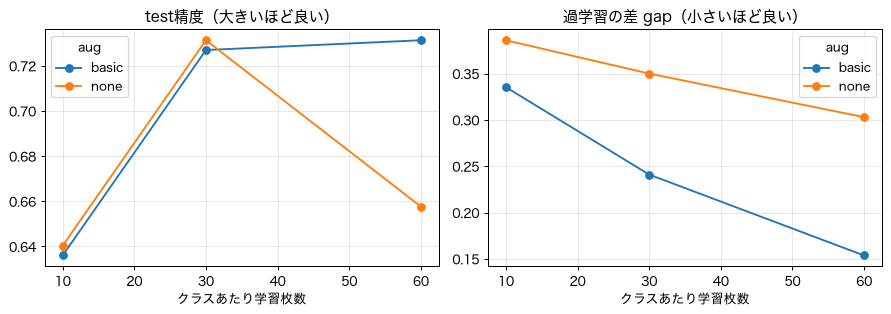

### 読み取れること

**① アブレーション**
- **最も効いたのは、ランダム切り抜き**（0.701 → 0.835、**+13ポイント**）。写真ごとに、アリの**位置や大きさが違う**。切り抜きはそれを体験させるので効果が大きい。
- **水平反転も効いた**（+5.6ポイント）。
- **色調変更だけでは効果なし**（0.701のまま、ばらつきも大きい）。アリとハチを見分ける手がかりは**形**で、**色の変化は役に立たなかった**と考えられる。
- **全部入り（0.796）より、切り抜き単独（0.835）のほうが高い**。ただし標準偏差が0.04程度あり、**誤差の範囲**かもしれない。それでも「全部入りが最良とは限らない」ことは言える。
- **1種類ずつ試さないと、無駄な拡張（色調）に気付けない。**

**② 学習枚数**
- **gap（過学習）は、どの枚数でも拡張で小さくなる**（0.386→0.335、0.350→0.241、0.303→0.154）。
- しかし、**testが改善したのは60枚/クラスのときだけ**（0.658 → 0.731）。**10枚・30枚では変わらない**。
- つまり**拡張は「データの代わり」にならない**。拡張は「今あるデータの見え方を変える」だけで、**新しい情報は作れない**。極端に少ないときは、**写真を増やす**か、**転移学習**（次のNotebook）に頼る。
- testは約77枚でばらつきが大きい（±0.04〜0.10）ため、これは**傾向の確認**にとどまる。

### 演習
- 切り抜きの強さ `scale=(0.2, 1.0)` を試す（終わったら戻す）
- **垂直反転**（`vflip`）を `AUG_SETS` に追加して比べる（コードを書き足す練習）
- （コード不要）**熟したバナナと未熟なバナナ**を分類するなら、色調変更は使うべきか？

---

## 05. 発展手法と転移学習 — [05_advanced.ipynb](05_advanced.ipynb)

**このNotebookのゴール**: ① 拡張の選び方を**おまかせ**にする**自動拡張**を知る。② **画像を混ぜる**拡張（Mixup / CutMix）が**向かない**場面を知る。③ **転移学習**が、少ない写真のときに**拡張よりはるかに効く**ことを体験する。④ 演習全体の**実践的な指針**をまとめる。

**やること**
1. 自動拡張（TrivialAugment / RandAugment）の見た目を見る
2. Mixup / CutMix の見た目と、ソフトラベル（「アリ80%・ハチ20%」）を見る
3. ゼロから学習して、拡張を比べる（150エポック）
4. **転移学習**（ImageNetで学習済みのResNet18を借りる）を試す

### 実行結果

**① 自動拡張**（上段: TrivialAugment ／ 下段: RandAugment。毎回違う加工が自動でかかる）

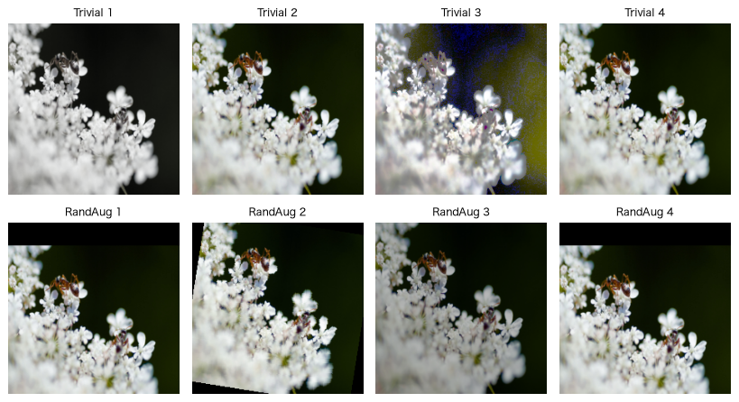

**② Mixup / CutMix**（タイトルの `[アリ,ハチ]` は混ぜたラベルの割合。Mixupは2枚を重ね、CutMixは一部を別の写真に貼り替える）

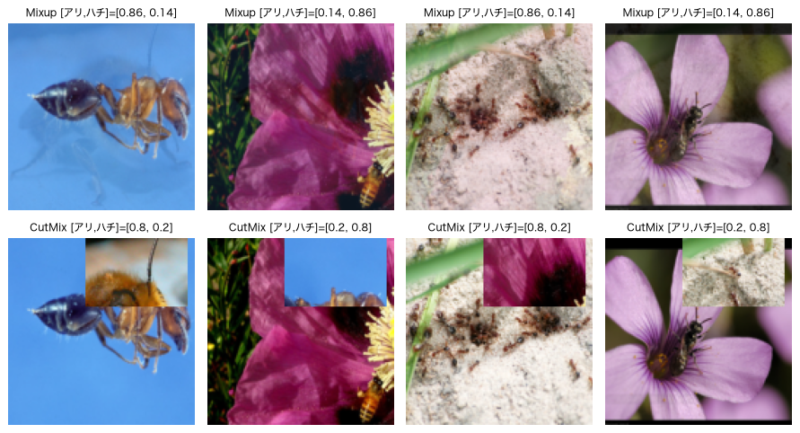

**③ ゼロから学習: 拡張の比較**（小さなCNN・150エポック・3シード平均）

| 条件 | train | val | test | gap |
|---|---|---|---|---|
| 拡張なし | 0.945 | 0.711 | **0.701** ±0.034 | 0.235 |
| 切り抜きのみ | 0.915 | 0.737 | **0.835** ±0.040 | 0.178 |
| 切り抜き+反転 | 0.885 | 0.710 | **0.801** ±0.053 | 0.174 |
| TrivialAugment | 0.794 | 0.720 | **0.792** ±0.039 | 0.075 |
| RandAugment | 0.796 | 0.702 | **0.844** ±0.060 | 0.094 |
| 切り抜き+反転+Mixup | 0.693 | 0.702 | **0.753** ±0.081 | -0.009 |
| 切り抜き+反転+CutMix | 0.787 | 0.702 | **0.714** ±0.039 | 0.086 |

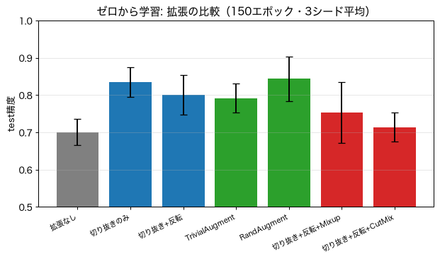

**④ 転移学習**（ImageNet学習済みResNet18・15エポック・3シード平均）

| データ | 条件 | train | val | test | gap |
|---|---|---|---|---|---|
| 全243枚 | 拡張なし | 1.000 | 0.829 | **0.892** ±0.008 | 0.171 |
| 全243枚 | 切り抜き+反転 | 1.000 | 0.855 | **0.939** ±0.030 | 0.145 |
| 全243枚 | TrivialAugment | 0.970 | 0.820 | **0.905** ±0.020 | 0.149 |
| 全243枚 | 切り抜き+反転+CutMix | 0.827 | 0.781 | **0.913** ±0.040 | 0.046 |
| 10枚/クラス | 拡張なし | 1.000 | 0.741 | **0.783** ±0.046 | 0.259 |
| 10枚/クラス | 切り抜き+反転 | 1.000 | 0.803 | **0.805** ±0.091 | 0.197 |

**⑤ ゼロから学習 vs 転移学習**（全243枚・test精度）

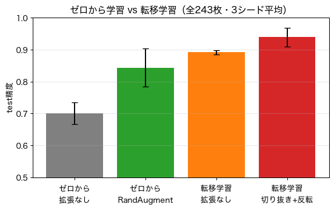

### 読み取れること
- **RandAugment（自動拡張）は、人が選んだ組み合わせと同等以上**（0.844）。どの拡張にするか迷ったら、まず試す価値がある。ただし標準偏差が0.04〜0.06あり、切り抜き単独との差は誤差の範囲。
- **Mixup・CutMixは逆効果**（0.753、0.714）。小さなAI・少ない写真では、混ぜた難しい写真を学習しきれない。Mixupでは train精度が **0.693** まで下がり、gapもほぼ0（＝**未学習**）。**「新しい手法＝良い手法」ではなく、自分の規模で試して確かめる**ことが大切。
- **最大の改善要因は転移学習。** 拡張なしでも **0.701 → 0.892（+19ポイント）**。クラスあたり10枚でも、ゼロから学習の 0.640 → **0.783**。
- **拡張は転移学習の上の「上積み」**（0.892 → 0.939、+4.7ポイント）。拡張だけでは届かない水準に、転移学習が連れて行ってくれる。
- 転移学習では、**train精度が1.000でも test が高い**。**「train が高い＝悪い」とは限らず**、val / test で判断する。
- 転移学習でも、TrivialAugment（0.905）や CutMix（0.913）は、切り抜き+反転（0.939）より低い。**強い拡張が常に良いわけではない**。

### 演習
- RandAugment の強さ `magnitude=3` を試す（終わったら `9` に戻す）
- 転移学習の学習率を `1e-2`（100倍）にして、**借りた知識を壊す**様子を見る
- （コード不要）**自分の課題**（写真200枚）に、下の指針を当てはめて、最初に試すことを書き出す

---

## まとめ: 少ない写真で画像分類するときの指針

この演習の結論です。

| 順番 | やること | 根拠（この演習の結果） |
|---|---|---|
| 1 | **まず転移学習**（学習済みAIを借りる） | 拡張なしでも +19ポイント。拡張よりはるかに効く |
| 2 | 拡張は**切り抜き＋水平反転**から | ゼロから学習で +13ポイント。副作用が少ない |
| 3 | 迷ったら **RandAugment / TrivialAugment** | 調整なしで、手作りの組み合わせに匹敵 |
| 4 | 拡張は**1種類ずつ**試して効果を確かめる | 色調のように、無駄な拡張に気付ける |
| 5 | 拡張ありは学習が遅い。**十分な回数**で比べる | 60エポックでは見えず、150エポックで効果が出た |
| 6 | **Mixup / CutMix は小さなAIでは慎重に** | 未学習になり、逆効果だった |
| 7 | 拡張は**データの代わりにならない**。極端に少ないなら**写真を増やす** | 10〜30枚/クラスでは test が上がらなかった |
| 8 | 比較は**複数シードの平均**で。小さな差を過信しない | val/test が少ないと結果がぶれる |
| 9 | **分割は拡張の前・拡張は train だけ・test は最後に1回だけ** | データリークとカンニングを避ける |

---

## 実行方法

```bash
.venv/bin/jupyter lab notebooks/
```

- カーネルは **Python (image_augment_lab)** を選ぶ。`No module named 'torch'` が出たら、カーネルが別の環境になっている。
  一覧に無いときは `.venv/bin/python -m ipykernel install --user --name image_augment_lab --display-name "Python (image_augment_lab)"` で登録する。
- 各Notebook冒頭の `QUICK = True` は1シードの短時間版、`False` は3シード（このページと同条件、時間は約3倍）。
- `NB_FAST=1` を付けて起動すると、エポック数が1/25になり**動作確認だけ**できる（数値に意味はない）。
- Notebookは `outputs/results.csv` を書き換えない。コマンドラインでの実行は [../README.md](../README.md) を参照。

## このページの図・表について

- `images/` の図は、実データ（拡張をかけた写真、学習曲線、`outputs/results.csv` の集計）から作成した。
- 学習曲線（02）は、シード0を再学習して描いた。再学習しても記録と同じ値（train 0.860 / val 0.671 / test 0.792）が再現された。
- 03 の学習曲線は、本実験（150エポック）で保存した学習履歴を使った。
